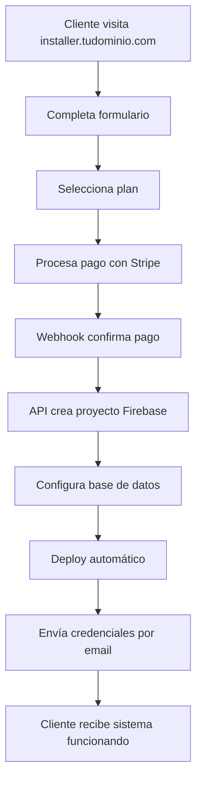

# 🌐 VERCEL DEPLOYMENT - GUÍA PRÁCTICA ACTUALIZADA

## 🚀 **CONFIGURACIÓN COMPLETA VERCEL + INSTALLER**

### 📂 **ESTRUCTURA DE ARCHIVOS PARA VERCEL**

```
installer/
├── vercel.json              # ⚙️ Configuración principal
├── index.html               # 🏠 Página de inicio
├── install.html             # 🔧 Página de instalación
├── admin.html               # 👨‍💼 Panel administrativo
├── api/
│   ├── install.js           # 📡 API de instalación
│   ├── webhook.js           # 🔗 Webhooks de pago
│   └── admin.js             # 🛠️ API administrativa
├── public/
│   ├── css/
│   ├── js/
│   └── images/
├── package.json             # 📦 Dependencias
└── README.md                # 📚 Documentación
```

### ⚙️ **vercel.json - CONFIGURACIÓN COMPLETA**

```json
{
  "version": 2,
  "name": "control-stock-installer",
  "description": "Sistema de instalación automática para Control de Stock",
  "builds": [
    {
      "src": "api/**/*.js",
      "use": "@vercel/node"
    },
    {
      "src": "public/**",
      "use": "@vercel/static"
    }
  ],
  "routes": [
    {
      "src": "/",
      "dest": "/index.html"
    },
    {
      "src": "/install",
      "dest": "/install.html"
    },
    {
      "src": "/admin",
      "dest": "/admin.html"
    },
    {
      "src": "/api/(.*)",
      "dest": "/api/$1"
    }
  ],
  "env": {
    "NODE_ENV": "production",
    "FIREBASE_ADMIN_KEY": "@firebase-admin-key",
    "STRIPE_SECRET_KEY": "@stripe-secret-key",
    "WEBHOOK_SECRET": "@webhook-secret"
  },
  "functions": {
    "api/**/*.js": {
      "maxDuration": 30
    }
  }
}
```

### 📦 **package.json - DEPENDENCIAS**

```json
{
  "name": "control-stock-installer",
  "version": "2.0.0",
  "description": "Installer automático para sistema de control de stock",
  "main": "index.js",
  "scripts": {
    "dev": "vercel dev",
    "build": "echo 'No build step required'",
    "deploy": "vercel --prod"
  },
  "dependencies": {
    "firebase-admin": "^12.0.0",
    "stripe": "^14.0.0",
    "axios": "^1.6.0",
    "dotenv": "^16.3.0"
  },
  "engines": {
    "node": ">=18.0.0"
  }
}
```

---

## 🔧 **APIS NECESARIAS**

### 📡 **api/install.js - INSTALACIÓN AUTOMÁTICA**

```javascript
import { initializeApp, cert } from "firebase-admin/app";
import { getFirestore } from "firebase-admin/firestore";
import { getAuth } from "firebase-admin/auth";

const admin = initializeApp({
  credential: cert(JSON.parse(process.env.FIREBASE_ADMIN_KEY)),
});

export default async function handler(req, res) {
  if (req.method !== "POST") {
    return res.status(405).json({ error: "Method not allowed" });
  }

  try {
    const { companyName, adminEmail, adminPassword, projectId, plan } =
      req.body;

    // 1. Crear proyecto Firebase
    const projectData = await createFirebaseProject({
      projectId,
      companyName,
    });

    // 2. Configurar autenticación
    const authData = await setupAuthentication({
      adminEmail,
      adminPassword,
    });

    // 3. Crear base de datos
    const dbData = await setupFirestore({
      projectId,
      plan,
    });

    // 4. Deploy del código
    const deployData = await deployApplication({
      projectId,
      companyName,
      plan,
    });

    // 5. Configurar dominio
    const domainData = await setupDomain({
      projectId,
      companyName,
    });

    res.status(200).json({
      success: true,
      data: {
        projectId,
        url: `https://${projectId}.web.app`,
        adminUrl: `https://${projectId}.web.app/admin`,
        credentials: {
          email: adminEmail,
          tempPassword: "change-on-first-login",
        },
      },
    });
  } catch (error) {
    console.error("Installation error:", error);
    res.status(500).json({
      success: false,
      error: error.message,
    });
  }
}

// Funciones auxiliares
async function createFirebaseProject(data) {
  // Lógica para crear proyecto Firebase
  // Usar Firebase Management API
}

async function setupAuthentication(data) {
  // Configurar Firebase Auth
}

async function setupFirestore(data) {
  // Crear colecciones y reglas de seguridad
}

async function deployApplication(data) {
  // Deploy del código a Firebase Hosting
}

async function setupDomain(data) {
  // Configurar dominio personalizado
}
```

### 💳 **api/webhook.js - WEBHOOKS DE PAGO**

```javascript
import Stripe from "stripe";

const stripe = new Stripe(process.env.STRIPE_SECRET_KEY);

export default async function handler(req, res) {
  if (req.method !== "POST") {
    return res.status(405).end();
  }

  const sig = req.headers["stripe-signature"];
  let event;

  try {
    event = stripe.webhooks.constructEvent(
      req.body,
      sig,
      process.env.WEBHOOK_SECRET
    );
  } catch (err) {
    console.error("Webhook signature verification failed:", err.message);
    return res.status(400).send(`Webhook Error: ${err.message}`);
  }

  // Manejar eventos de pago
  switch (event.type) {
    case "payment_intent.succeeded":
      await handlePaymentSuccess(event.data.object);
      break;

    case "payment_intent.payment_failed":
      await handlePaymentFailed(event.data.object);
      break;

    default:
      console.log(`Unhandled event type ${event.type}`);
  }

  res.json({ received: true });
}

async function handlePaymentSuccess(paymentIntent) {
  // Procesar pago exitoso
  // Activar instalación automática
  const { customer_email, metadata } = paymentIntent;

  // Trigger instalación
  await fetch("/api/install", {
    method: "POST",
    headers: { "Content-Type": "application/json" },
    body: JSON.stringify({
      companyName: metadata.company_name,
      adminEmail: customer_email,
      plan: metadata.plan,
      projectId: metadata.project_id,
    }),
  });
}
```

---

## 🚀 **DEPLOYMENT STEP BY STEP**

### 1️⃣ **PREPARACIÓN LOCAL**

```bash
# 1. Instalar Vercel CLI
npm install -g vercel

# 2. Login a Vercel
vercel login

# 3. Navegar a carpeta installer
cd installer

# 4. Instalar dependencias
npm install

# 5. Configurar variables de entorno locales
cp .env.example .env.local
```

### 2️⃣ **CONFIGURAR VARIABLES DE ENTORNO**

```bash
# En Vercel Dashboard o CLI
vercel env add FIREBASE_ADMIN_KEY production
vercel env add STRIPE_SECRET_KEY production
vercel env add WEBHOOK_SECRET production
vercel env add NODE_ENV production
```

**Valores de ejemplo:**

```
FIREBASE_ADMIN_KEY={"type":"service_account","project_id":"..."}
STRIPE_SECRET_KEY=sk_live_...
WEBHOOK_SECRET=whsec_...
NODE_ENV=production
```

### 3️⃣ **PRIMER DEPLOYMENT**

```bash
# Deploy inicial
vercel

# Responder preguntas:
# ? Set up and deploy "installer"? [Y/n] y
# ? Which scope? Your Personal Account
# ? Link to existing project? [y/N] n
# ? What's your project's name? control-stock-installer
# ? In which directory is your code located? ./

# Deploy a producción
vercel --prod
```

### 4️⃣ **CONFIGURAR DOMINIO CUSTOM**

```bash
# Agregar dominio
vercel domains add installer.tudominio.com

# Configurar DNS
# A Record: installer -> 76.76.19.61
# CNAME: www.installer -> cname.vercel-dns.com
```

---

## 💰 **INTEGRACIÓN CON STRIPE**

### 🔧 **CONFIGURACIÓN STRIPE**

```javascript
// public/js/checkout.js
const stripe = Stripe("pk_live_...");

const plans = {
  basic: {
    price: "price_basic_monthly",
    amount: 4000, // $40.00
    setup: 60000, // $600.00
  },
  pro: {
    price: "price_pro_monthly",
    amount: 7000, // $70.00
    setup: 90000, // $900.00
  },
  enterprise: {
    price: "price_enterprise_monthly",
    amount: 12000, // $120.00
    setup: 150000, // $1500.00
  },
};

async function createCheckout(plan, companyData) {
  const response = await fetch("/api/create-checkout", {
    method: "POST",
    headers: { "Content-Type": "application/json" },
    body: JSON.stringify({
      plan: plan,
      company: companyData,
      success_url: `${window.location.origin}/success?plan=${plan}`,
      cancel_url: `${window.location.origin}/cancel`,
    }),
  });

  const { url } = await response.json();
  window.location.href = url;
}
```

### 💳 **api/create-checkout.js**

```javascript
import Stripe from "stripe";

const stripe = new Stripe(process.env.STRIPE_SECRET_KEY);

export default async function handler(req, res) {
  if (req.method !== "POST") {
    return res.status(405).json({ error: "Method not allowed" });
  }

  try {
    const { plan, company, success_url, cancel_url } = req.body;

    const session = await stripe.checkout.sessions.create({
      payment_method_types: ["card"],
      line_items: [
        {
          price_data: {
            currency: "usd",
            product_data: {
              name: `Control de Stock - Plan ${plan.toUpperCase()}`,
              description: `Instalación completa + primer mes incluido`,
            },
            unit_amount: getPlanSetupPrice(plan),
          },
          quantity: 1,
        },
      ],
      mode: "payment",
      success_url: success_url,
      cancel_url: cancel_url,
      customer_email: company.adminEmail,
      metadata: {
        plan: plan,
        company_name: company.name,
        project_id: generateProjectId(company.name),
        admin_email: company.adminEmail,
      },
    });

    res.status(200).json({ url: session.url });
  } catch (error) {
    res.status(500).json({ error: error.message });
  }
}

function getPlanSetupPrice(plan) {
  const prices = {
    basic: 60000, // $600
    pro: 90000, // $900
    enterprise: 150000, // $1500
  };
  return prices[plan] || 60000;
}

function generateProjectId(companyName) {
  return companyName
    .toLowerCase()
    .replace(/[^a-z0-9]/g, "-")
    .replace(/-+/g, "-")
    .substring(0, 30);
}
```

---

## 📊 **DASHBOARD ADMINISTRATIVO**

### 🖥️ **admin.html - PANEL DE CONTROL**

```html
<!DOCTYPE html>
<html lang="es">
  <head>
    <meta charset="UTF-8" />
    <meta name="viewport" content="width=device-width, initial-scale=1.0" />
    <title>Admin Panel - Control de Stock Installer</title>
    <style>
      .dashboard {
        padding: 20px;
        font-family: Arial, sans-serif;
      }
      .stats {
        display: grid;
        grid-template-columns: repeat(4, 1fr);
        gap: 20px;
      }
      .stat-card {
        background: #f5f5f5;
        padding: 20px;
        border-radius: 8px;
      }
      .clients-table {
        width: 100%;
        margin-top: 30px;
      }
      .clients-table th,
      .clients-table td {
        padding: 12px;
        text-align: left;
      }
    </style>
  </head>
  <body>
    <div class="dashboard">
      <h1>Control de Stock - Panel Administrativo</h1>

      <div class="stats">
        <div class="stat-card">
          <h3>Clientes Activos</h3>
          <p id="activeClients">0</p>
        </div>
        <div class="stat-card">
          <h3>Ingresos del Mes</h3>
          <p id="monthlyRevenue">$0</p>
        </div>
        <div class="stat-card">
          <h3>Instalaciones</h3>
          <p id="installations">0</p>
        </div>
        <div class="stat-card">
          <h3>Tasa de Conversión</h3>
          <p id="conversionRate">0%</p>
        </div>
      </div>

      <table class="clients-table">
        <thead>
          <tr>
            <th>Cliente</th>
            <th>Plan</th>
            <th>Estado</th>
            <th>Instalación</th>
            <th>Último Pago</th>
            <th>Acciones</th>
          </tr>
        </thead>
        <tbody id="clientsTableBody">
          <!-- Datos cargados vía JavaScript -->
        </tbody>
      </table>
    </div>

    <script src="/js/admin-dashboard.js"></script>
  </body>
</html>
```

---

## 🔄 **AUTOMATIZACIÓN COMPLETA**

### ⚡ **FLUJO AUTOMATIZADO**



### 📧 **NOTIFICACIONES AUTOMÁTICAS**

```javascript
// api/send-notification.js
import nodemailer from "nodemailer";

const transporter = nodemailer.createTransporter({
  service: "gmail",
  auth: {
    user: process.env.EMAIL_USER,
    pass: process.env.EMAIL_PASSWORD,
  },
});

export async function sendInstallationComplete(clientData) {
  const mailOptions = {
    from: process.env.EMAIL_USER,
    to: clientData.adminEmail,
    subject: "🚀 Su sistema Control de Stock está listo!",
    html: `
      <h2>¡Bienvenido a Control de Stock!</h2>
      
      <p>Su sistema ha sido instalado exitosamente:</p>
      
      <ul>
        <li><strong>URL:</strong> <a href="${clientData.url}">${clientData.url}</a></li>
        <li><strong>Email:</strong> ${clientData.adminEmail}</li>
        <li><strong>Contraseña temporal:</strong> ${clientData.tempPassword}</li>
      </ul>
      
      <p><strong>Siguientes pasos:</strong></p>
      <ol>
        <li>Acceda a su sistema</li>
        <li>Cambie su contraseña</li>
        <li>Configure su empresa</li>
        <li>Cargue sus primeros materiales</li>
      </ol>
      
      <p>¿Necesita ayuda? Responda a este email o contacte soporte.</p>
    `,
  };

  await transporter.sendMail(mailOptions);
}
```

---

## ✅ **CHECKLIST DE DEPLOYMENT**

### 📋 **ANTES DE LANZAR**

- [ ] Vercel CLI instalado y configurado
- [ ] Variables de entorno configuradas
- [ ] Stripe configurado con webhooks
- [ ] Firebase Admin SDK configurado
- [ ] Dominio personalizado configurado
- [ ] Email notifications funcionando
- [ ] Testing completo en staging
- [ ] Documentación actualizada
- [ ] Monitoreo y logs configurados

### 🚀 **POST-DEPLOYMENT**

- [ ] Verificar URL principal funciona
- [ ] Probar flujo de pago completo
- [ ] Verificar instalación automática
- [ ] Confirmar notificaciones por email
- [ ] Revisar dashboard administrativo
- [ ] Backup de configuraciones
- [ ] Documentar credenciales importantes

---

_Guía actualizada: Diciembre 8, 2025_  
_Versión: 2.0 - Deployment Completo_  
_Autor: David Montenegro_
